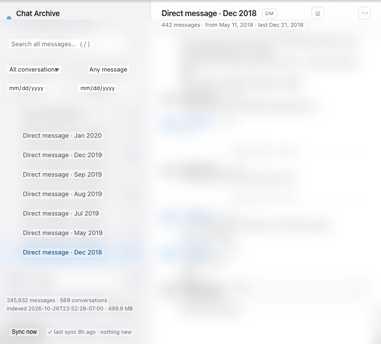
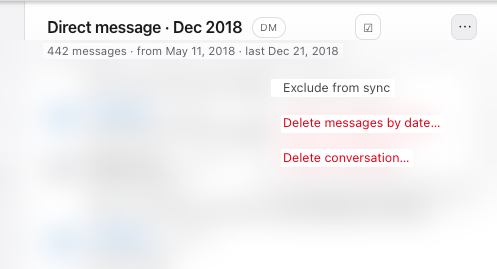
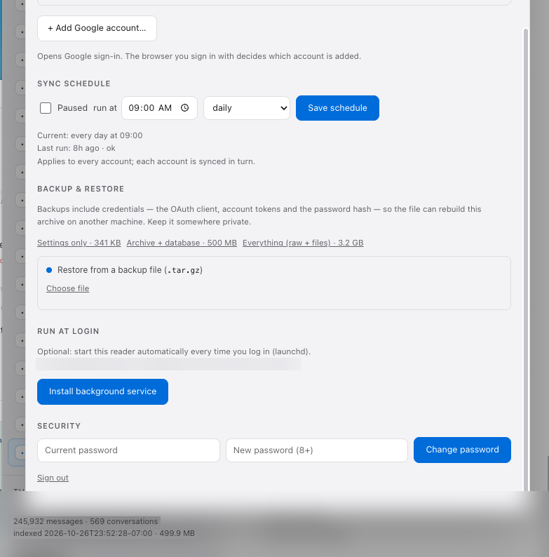
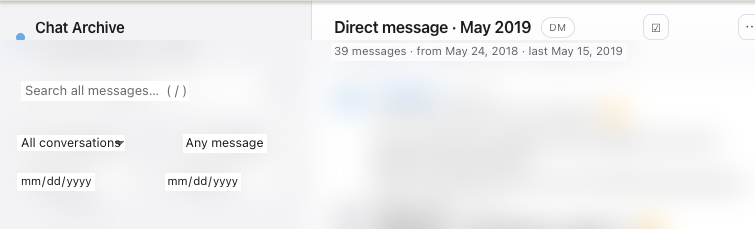

# gchat-archive — export, search and back up your Google Chat history offline

[](https://www.buymeacoffee.com/tu.nguyen.atwork)
[](https://pypi.org/project/gchat-archive/)
[](https://www.python.org/)
[](#install)
[](https://github.com/tunguyenatwork/gchat-archive/blob/main/LICENSE)

Keep a **local, searchable copy of your Google Chat history** — every space, group chat and DM — in SQLite with full-text search, a browser UI that works offline, and a nightly sync.

Google Chat has no export button. This gives you one:

- **Every message** in every conversation, incremental sync that resumes where it stopped
- **Full-text search** over message bodies, sender names, and the text inside shared documents (PDF, DOCX, XLSX, CSV, Google Docs/Sheets/Slides)
- **Browsable offline** — conversation list, date filters, attachment previews and download
- **Set up in the browser** — upload your OAuth client, sign in, done; no files to place by hand
- **Backup & restore from the UI** — one `.tar.gz` rebuilds the archive on a new machine
- **Optionally a background service** — starts at login, restarts if it stops
- **Yours only** — listens on `127.0.0.1`, never uploads anything, optional password
- **Multi-account** — several Google accounts, each with an isolated archive
- **Prune without losing anything upstream** — delete or exclude conversations and messages locally; Google Chat is never modified

macOS · Windows · Linux.

## Screenshots

| Browsing the archive | Pruning a conversation |
|---|---|
|  |  |

| Settings — accounts, schedule, backup, service | A single thread |
|---|---|
|  |  |

<sub>Message bodies are blurred in these screenshots — they contain real conversations. Everything else is the actual UI.</sub>

Two ways to collect, one archive:

| | **API source** (default) | **Browser source** (no setup) |
|---|---|---|
| Requires | Google Cloud OAuth client, ~5 min | only your signed-in Chrome |
| Gets | everything incl. attachments + document text | rendered messages |
| Stability | stable API | depends on Google's markup |

See [docs/BROWSER.md](https://github.com/tunguyenatwork/gchat-archive/blob/main/docs/BROWSER.md) for the browser source.

---

## Install

Requires **Python 3.10+**.

### macOS / Linux

```bash
pipx install "gchat-archive[text]"        # recommended: isolated, on your PATH
# or
python3 -m pip install --user "gchat-archive[text]"
```

### Windows (PowerShell)

```powershell
py -m pip install --user "pipx"
py -m pipx install "gchat-archive[text]"
```

`[text]` adds the document parsers (pypdf, python-docx, openpyxl, beautifulsoup4). Without it
everything still works — search just won't look inside attachments. Installing from git works too:
`pipx install git+https://github.com/tunguyenatwork/gchat-archive.git`, then
`pipx inject gchat-archive pypdf python-docx openpyxl beautifulsoup4`.

First time with `pipx`? **[docs/INSTALL.md](https://github.com/tunguyenatwork/gchat-archive/blob/main/docs/INSTALL.md)**
walks through installing it, checking the result, and removing everything again. Something broken?
**[docs/TROUBLESHOOTING.md](https://github.com/tunguyenatwork/gchat-archive/blob/main/docs/TROUBLESHOOTING.md)**.

### From a checkout

```bash
git clone https://github.com/tunguyenatwork/gchat-archive.git
cd gchat-archive
python3 -m venv .venv && . .venv/bin/activate      # Windows: .venv\Scripts\activate
pip install -e ".[text,dev]"
pytest
```

---

## Set up (in the browser)

```bash
gchat-archive serve --open           # → http://127.0.0.1:8765
```

A fresh install opens **`/setup`** by itself:

1. **Create the OAuth client.** The page links every step — new project → enable **Google Chat API**
   and **Google Drive API** → OAuth consent screen (*External*, add yourself as a test user, four
   scopes) → **Credentials → Create credentials → OAuth client ID → Desktop app** → **Download JSON**.
   Free, no billing account, about five minutes.
2. **Upload that JSON** — drag and drop or click to choose. It is validated: a *web* client is
   rejected with a hint to recreate it as *Desktop app*, broken JSON is named as such. Stored
   owner-only at `~/.gchat-archive/client_secret.json`. Replace it any time from
   Settings → Google accounts.
3. **Continue to Google sign-in** and pick the account to archive. Add more accounts later from the
   same panel.
4. **Sync.** The first run downloads everything (~40 min for a 240k-message archive). Watch it in the
   UI or run `gchat-archive sync`.
5. **Set a password** (Settings → Security) if the machine is shared.

Prefer files to clicks? Put the JSON at `~/.gchat-archive/client_secret.json` (or point
`GCHAT_CLIENT_SECRET` at it) and run `gchat-archive login` — same flow. Full walkthrough with
troubleshooting: **[docs/SETUP.md](https://github.com/tunguyenatwork/gchat-archive/blob/main/docs/SETUP.md)**.

---

## Move to a new machine

Everything travels in one file.

**Old machine** — Settings → **Backup & restore** → pick a size:

| Kind | Contains | Typical |
|---|---|---|
| Settings only | OAuth client, account registry, password hash, rules, sync watermarks | ~40 KB |
| **Archive + database** | the above + `chats.sqlite` (all messages + search index) | ~150 MB compressed |
| Everything | the above + `raw/` messages and downloaded attachments | ~3 GB |

**New machine:**

```bash
pipx install "gchat-archive[text]"
gchat-archive serve --open
```

Settings → **Backup & restore** → choose the file. An empty install installs it directly; an existing
archive asks first (showing the backup's date, kind and message count) and copies the current settings
to `pre-restore-<timestamp>/`. Reload, enter the same password — history, rules and Google credentials
are all there, so the next `sync` continues where the old machine stopped.

CLI equivalents:

```bash
gchat-archive backup --kind archive --out ~/Desktop/gca.tar.gz   # old machine
gchat-archive restore ~/Desktop/gca.tar.gz                      # new machine
```

Backups **contain credentials** (client secret, tokens, password hash) — that is what makes a restore
self-sufficient, so store the file somewhere private.

---

## Run it in the background (optional)

Settings → **Run at login** installs the reader as a per-user service, so the archive is available
whenever you are logged in:

| Platform | Mechanism | Where |
|---|---|---|
| macOS | LaunchAgent (`RunAtLoad`, `KeepAlive`) | `~/Library/LaunchAgents/com.gchat-archive.serve.plist` |
| Linux | `systemd --user` unit (`Restart=on-failure`) | `~/.config/systemd/user/gchat-archive.service` |
| Windows | Task Scheduler, at logon | task `gchat-archive serve` |

```bash
gchat-archive service install [--port 8765]
gchat-archive service status
gchat-archive service uninstall
```

Logs land in `~/.gchat-archive/service.log` and `service.err.log`. Stop a hand-started instance before
installing, or the service has no port to bind. On Linux, `loginctl enable-linger $USER` keeps it
running while you are logged out.

The nightly sync is a separate, also-optional schedule:

```bash
gchat-archive schedule set "0 5 * * *"     # crontab on macOS/Linux, Task Scheduler on Windows
gchat-archive schedule status
```

---

## Commands

| Command | What it does |
|---|---|
| `gchat-archive serve` | Reader UI on <http://127.0.0.1:8765> (`--port`, `--open`) |
| `gchat-archive login` | Add a Google account (opens `/setup` until a client is uploaded) |
| `gchat-archive sync` | Fetch new messages → attachments → rebuild the database |
| `gchat-archive sync --full` | Re-pull every conversation from scratch |
| `gchat-archive sync --check-all` | Also re-check conversations that look idle (catches edits/deletes) |
| `gchat-archive build` | Rebuild `chats.sqlite` from downloaded messages |
| `gchat-archive attachments download [N]` / `stats` | Manage attachment files |
| `gchat-archive accounts list\|use\|remove` | Manage accounts |
| `gchat-archive backup [--kind config\|archive\|full]` | Write a restorable `.tar.gz` |
| `gchat-archive restore FILE [--force]` | Install a backup (config, database, rules) |
| `gchat-archive service install\|status\|uninstall` | Run the reader at login |
| `gchat-archive schedule set\|pause\|resume\|status` | Nightly sync |
| `gchat-archive doctor` | Check the install: paths, token, optional parsers |
| `gchat-archive browser launch\|calibrate\|harvest` | Harvest through a signed-in Chrome instead |

`--data-dir PATH` (or `GCHAT_ARCHIVE_HOME`) moves the archive anywhere.

---

## What gets stored

```
~/.gchat-archive/
├── client_secret.json          your OAuth client (owner-only)
├── auth.json                   archive password hash (owner-only)
├── accounts.json               which accounts exist, which is active
├── tokens/<slug>.json          OAuth tokens, owner-only
└── accounts/<slug>/
    ├── raw/<space>.jsonl       append-only API responses, one JSON per line
    ├── raw/<space>.meta.json   conversation metadata
    ├── state.json              per-conversation watermarks
    ├── chats.sqlite            the searchable database (a projection of raw)
    ├── attachments/            downloaded files
    ├── attachments.jsonl       what was downloaded
    ├── attachments_text.jsonl  text extracted from those files
    └── archive_manage.json     your delete/exclude rules
```

The database is **disposable** — it is rebuilt from `raw/` minus `archive_manage.json` on every sync.
Deleting a message or conversation in the UI records it in the rules file, so a rebuild cannot
resurrect it, and removing the rule brings it back.

Everything stays on your machine. The only network traffic is to Google's APIs.

---

## Notes and limits

- **Scopes**: `chat.messages`, `chat.spaces.readonly`, `drive`, `gmail.readonly`. `drive` is needed to export Google Docs/Sheets; `gmail.readonly` only to learn your own address.
- **Edits and deletions upstream** are picked up when a conversation is re-read. Idle conversations are skipped for speed — run `sync --check-all` weekly if you care about old edits.
- **Images** are opt-in (Settings per account): ~1.7 GB for a 240k-message archive. They are stored, not OCR'd.
- **Video and other binaries** are skipped; their filenames are still indexed.
- **The nightly sync** needs the machine awake; a laptop that sleeps through 05:00 simply syncs on the next run.
- This is a personal archive tool, not a compliance/retention system.

---

## Security

- Binds to `127.0.0.1` by default — not reachable from your network
- Optional password (Settings → Security): PBKDF2 hash, in-memory sessions, password reset by email to the linked account
- Credentials, tokens and backups are stored owner-only; `.gitignore` keeps them out of git
- Revoke access any time at <https://myaccount.google.com/permissions>

---

## Browser source (no OAuth)

```bash
pip install "gchat-archive[browser]"
# quit Chrome, then:
gchat-archive browser launch --profile "Profile 21"
gchat-archive browser calibrate                 # open a conversation first
gchat-archive browser harvest --conversation "project-room"
gchat-archive build && gchat-archive serve
```

It drives your signed-in Chrome over the DevTools protocol, scrolls the open conversation, and writes
the same `raw/*.jsonl` the API source writes. No Google Cloud project, no scopes, no token.
Experimental: it depends on the rendered DOM, which is why `calibrate` exists — it reports whether the
current markup is understood. Attachments are not collected in this mode. Details and limits:
[docs/BROWSER.md](https://github.com/tunguyenatwork/gchat-archive/blob/main/docs/BROWSER.md).

## Development

```bash
pip install -e ".[text,dev]"
pytest                     # offline: build, FTS, rules, backup/restore, CLI, endpoints
```

Layout: `src/gchat_archive/` — `api` (Chat REST), `fetch` (incremental sync), `build` (raw → SQLite/FTS5), `attachments`, `textract`, `manage` (rules), `accounts`, `auth`, `serve` (stdlib HTTP + UI), `backup`, `service`, `schedule`, `cli`. The browser app is plain HTML/CSS/JS in `src/gchat_archive/web/`, no build step.

Installing from a checkout into another location is a plain reinstall — the UI ships inside the wheel,
so re-run the install after changing anything under `web/`.

## Support

If this saved you an afternoon of scrolling, you can buy me a coffee:

<a href="https://www.buymeacoffee.com/tu.nguyen.atwork" target="_blank">
  
</a>

No obligation — starring the repo, filing a clear bug report or sending a PR helps just as much.

## License

MIT
